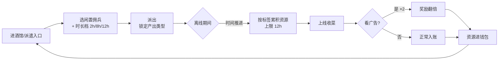
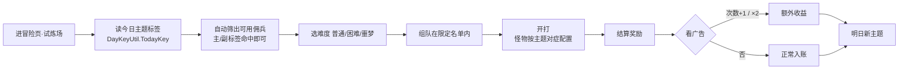
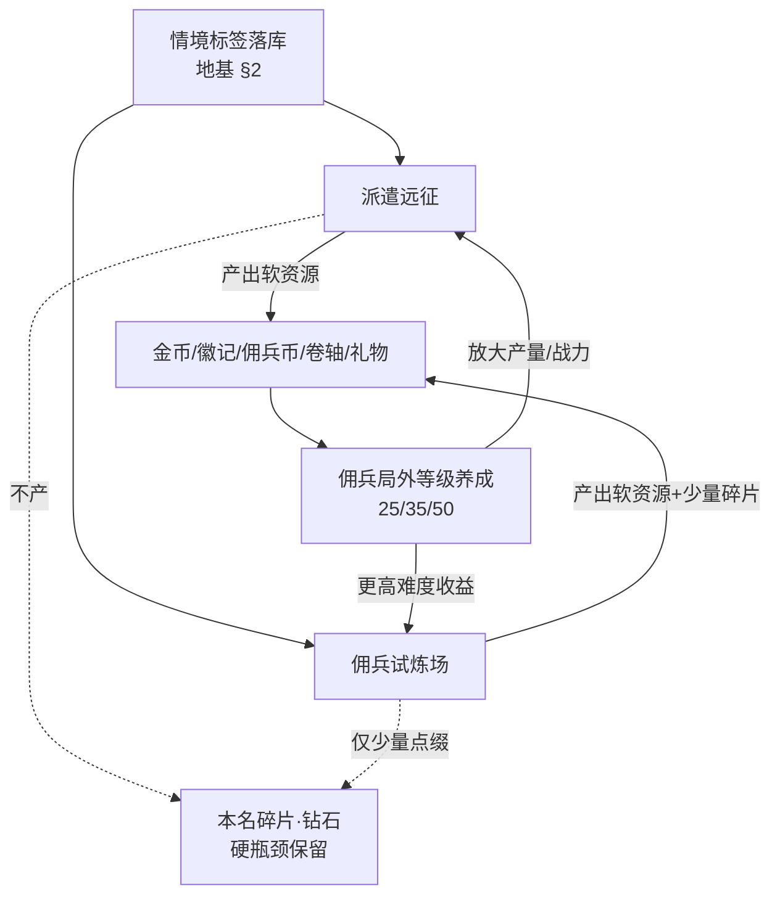

# 佣兵派遣远征 + 佣兵试炼场 · 玩法设计案（2026-11-17）

> 状态：**设计案，未动代码**。本文只给改造点、数值与验收标准，不含完整代码。
> 目标两个：① 补上"次日回访"钩子（派遣离线收益）；② 把 24 名佣兵的养成线盘活（试炼场限标签出战）。
> 前置地基：**战斗情境标签落库**——两个玩法都依赖它，必须先做（见 §2）。
> 硬边界：本设计**不碰局内升星**（已下线）、**不产本名碎片和钻石**（保住经济瓶颈），只动软资源。

---

## 1. 结论先行

| 项 | 派遣远征 | 佣兵试炼场 |
|---|---|---|
| 一句话 | 闲置佣兵挂机采集，离线累计，上线收菜 | 每天换一个情境主题，只能用对应佣兵打的关卡 |
| 核心钩子 | 次日回访（12h 档卡一夜） | 每日轮换 + 逼练冷门佣兵 |
| 广告位 | 收菜 ×2 / 立即完成 | 挑战次数 +1 / 结算 ×2 |
| 产出 | 金币 / 佣兵币 / 职业徽记 / 卷轴 / 礼物（软资源） | 金币 / 徽记 / 少量碎片 / 少量钻石 |
| 依赖地基 | 情境标签、派遣存档、离线计时 | 情境标签、副本框架、组队筛选 |
| 落地规模 | 中（新系统 + 新 UI） | 中（复用副本框架 + 轻 UI） |
| 建议顺序 | 第二做 | **第一做**（复用现成框架，验证标签） |

---

## 2. 前置地基：战斗情境标签落库（两玩法共同依赖）

### 2.1 现状（已核实）

- `Assets/Scripts/Config/MercRosterDefs.cs` 的 `struct Def`（第 19–45 行）只有职业、稀有度、技能、价格等字段，**没有 `MainTag`/`SubTag`**。
- 数值真源 `Assets/Data/Source/Tables/merc_roster.csv` 表头 17 列，同样没有标签列。
- 9 月的设计文档 `佣兵获取与定位设计_2026-09-17.md` §5.3 只给了 22 人标签分配，现已过时（新增了 H023/H024，H013/H015 已升传奇）。

**结论：标签目前只存在于旧设计文档，代码与表里都没有。两个新玩法都以它为基础，必须先补齐。**

### 2.2 标签定义（5 个，沿用旧设计，不新增概念）

| 标签 | 枚举建议 | 解决什么压力 |
|---|---|---|
| 🛡 高压承伤 | `Tank` | 怪伤害高、有爆发 |
| 🔥 群怪清场 | `Clear` | 一波十几个小怪 |
| ⚔ 单点攻坚 | `Boss` | Boss、精英高血量 |
| 💚 持久续航 | `Heal` | 关卡长、多波消耗 |
| 🏹 机动牵制 | `Control` | 快怪、远程怪堆脸 |

### 2.3 24 人标签分配（以当前 `MercRosterDefs.cs` 为准，已补 H023/H024、档位已对齐现状）

| ID | 名字 | 职业 | 当前档 | 主标签 | 副标签 |
|---|---|---|---|---|---|
| H001 | 马库斯·老盾 | 剑盾 | 普通 | 🛡承伤 | — |
| H002 | 洛恩·铁皮 | 剑盾 | 稀有 | 🛡承伤 | 🏹牵制 |
| H003 | 塔克·重盾 | 剑盾 | 稀有 | 🛡承伤 | 💚续航 |
| H004 | 维克·钢盾 | 剑盾 | 传说 | 🛡承伤 | 💚续航 |
| H005 | 米娅·小樱 | 游侠 | 普通 | 🏹牵制 | ⚔攻坚 |
| H006 | 希尔·鹰眼 | 游侠 | 稀有 | ⚔攻坚 | 🏹牵制 |
| H007 | 布罗克·大锤 | 狂战 | 普通 | ⚔攻坚 | — |
| H008 | 古恩·斩铁 | 狂战 | 稀有 | 🔥清场 | ⚔攻坚 |
| H009 | 莫丁·碎岩 | 狂战 | 稀有 | ⚔攻坚 | 🛡承伤 |
| H010 | 凯恩·狂牙 | 狂战 | 传说 | 🔥清场 | ⚔攻坚 |
| H011 | 路加 | 牧师 | 普通 | 💚续航 | — |
| H012 | 塞拉·蓝之泪 | 水系法 | 稀有 | 💚续航 | 🔥清场 |
| H013 | 莫娜·紫晶 | 雷系法 | **传说** | 💚续航 | 🏹牵制 |
| H014 | 伊芙·火舞 | 火系法 | 传说 | 🔥清场 | ⚔攻坚 |
| H015 | 艾拉·风羽 | 游侠 | **稀有** | 🏹牵制 | — |
| H016 | 杜娅·怒角 | 狂战 | 稀有 | 🔥清场 | — |
| H017 | 莉娜·圣光 | 牧师 | 稀有 | 💚续航 | — |
| H018 | 布朗·铁壁 | 剑盾 | 普通 | 🛡承伤 | — |
| H019 | 艾琳·星火 | 法师 | 普通 | 🔥清场 | — |
| H020 | 凯尔·谜面 | 法师 | 稀有 | 🏹牵制 | ⚔攻坚 |
| H021 | 格拉克斯·懒鬼 | 重武 | 普通 | 🛡承伤 | — |
| H022 | 索尔·铁面 | 重武 | 稀有 | 🔥清场 | 🛡承伤 |
| H023 | 加百列·赤壁 | 剑盾 | 稀有 | 🛡承伤 | 🏹牵制 |
| H024 | 奥蕾莉亚·圣辉 | 剑盾 | 传说 | 🛡承伤 | 💚续航 |

**分布自检**：主标签 承伤 8 / 清场 6 / 攻坚 3 / 续航 4 / 牵制 3。
每个情境可选数（主+副）：承伤 10 · 清场 7 · 攻坚 9 · 续航 7 · 牵制 8 → **全部 ≥6**，守住旧设计"每个情境都能过、没有唯一解"的红线。

### 2.4 地基落地清单

| 文件 | 改动 | 验收 |
|---|---|---|
| `Config/MercRosterDefs.cs` `struct Def`（19–45） | 加 `MercTag MainTag` / `SubTag` 两字段；加枚举；`D()`（179）与 `LoadTableFromCsv()`（117）各补一处赋值/解析 | 构造期不读表；`TryGetByHireId` 取到正确标签 |
| `Data/Source/Tables/merc_roster.csv` | 末尾加 `mainTag,subTag` 两列，按 §2.3 填 | Cook 成 `.bytes`，csv/bytes 同步 |
| `Assets/Editor/MercRosterConsistencyCheck.cs` | 三处同值校验器加两列比对 | 菜单跑校验全绿 |
| 名册卡面 / 详情 UI | 加一行 `🛡承伤 · 💚续航`（复用旧设计 §5.3 文案） | 24 人卡面标签显示正确 |

> 施工红线：改花名册走既有"CSV → Cook → 硬编码数组"三处同值流程（见 `MercRosterDefs.cs` 顶部注释），不许只改一处。

---

## 3. 玩法一：派遣远征

### 3.1 设计目标与一句话

**一句话**：把没上阵的佣兵派出去挂机，睡一觉回来收菜。

**要解决的真问题**：玩家 24 个佣兵，真正常用的就 5 个，剩下全在名册里吃灰。派遣给闲置佣兵一个用途，同时制造"明天再来"的理由——这是留存链里最便宜的一环。

### 3.2 核心循环

### 3.3 规则细则

1. **派遣位共 3 个**：第 1 位免费；第 2 位通关第 3 章解锁；第 3 位通关第 6 章解锁（复用 `SaveData.clearedChapterIds`，零新增货币）。
2. **只能派闲置佣兵**：已解锁、且未在本局出战名单里的佣兵。派出期间从"酒馆招募池 / 局内随机池"排除（复用现有排除逻辑，见 §5 接口点），**本局不会被抽到**——保证"派出去的不会半路被拉去打架"。
3. **时长档 2h / 8h / 12h**：档位决定收益倍率和广告"立即完成"的价格；12h 档正好卡一夜。
4. **离线累计上限 12h**：超过不再增长（防无限挂机膨胀）；在线与离线同一套计时，用 `lastSaveTime` 差值算（存档已有该字段）。
5. **收菜时广告 ×2**（可选），或花广告"立即完成"（跳过剩余时间）。
6. **标签决定产出**：每个情境标签对应一种软资源（见 §3.4）。稀有度与局外等级放大产量，但不改产出类型。
7. **不产本名碎片、不产钻石**——这两项是刻意留的硬瓶颈，派遣一碰，整个养成线就废了。

### 3.4 数值框架（初始建议值，标注"需实测调整"）

**标签 → 产出映射**（基准速率 = 普通档 Lv1、每小时）：

| 标签 | 产出资源 | 基准速率/h | 12h 累计（普通 Lv1，含时长折扣） | 设计意图 |
|---|---|---:|---:|---|
| 🛡承伤 | 职业徽记（按职业，低阶为主） | 0.06 | ≈0.55 个 | 守矿，慢而稳 |
| 🔥清场 | 金币 | 60 | ≈554 金 | 扫荡，量大 |
| ⚔攻坚 | 佣兵币 | 20 | ≈184 | Boss 掉落 |
| 💚续航 | 礼物（好感道具） | 0.10 | ≈0.92 个 | 治愈=照顾人 |
| 🏹牵制 | 卷轴 | 0.08 | ≈0.74 个 | 截获 |

**放大系数**：
- 稀有度：普通 1.0 / 稀有 1.3 / 传说 1.7（复用花名册稀有度理念）。
- 局外等级：`1 + 0.01 × (Lv−1)`（Lv25=1.24 / Lv35=1.34 / Lv50=1.49）。
- 时长折扣（鼓励短频收菜，同时不惩罚挂机过夜）：2h=1.00 / 8h=0.85 / 12h=0.77。

**极端值自检**：满级传奇清场档 12h ≈ 60×12×0.77×1.7×1.49 ≈ 1400 金；3 个位全这样、一天两轮 ≈ 8400 金/天。对照八章累计约 9.9 万金——派遣是补充，不是主来源，推图仍是金币大盘。✅

**防膨胀闸**：
- 单标签每日派遣产出设软上限（建议：金币 ≤1.5 万/天、徽记 ≤6 个/天），超出部分按 50% 递减（UI 明示"今日该资源已过热"）。
- 时长折扣 + 上限双保险，理财式挂机收益永远追不上一局战斗。

### 3.5 广告设计（复用 `SettleDoubleAd` 模板）

| 广告位 placement | 场景 | 规则 |
|---|---|---|
| `expedition_double` | 收菜时奖励 ×2 | 每日 3 次（独立计数，不占结算双倍额度） |
| `expedition_instant` | 未到点立即完成 | 每日 2 次，按剩余时间比例折算产出（不超 12h 上限） |

- 全部走 `RewardedAdBridge.ShowRewarded(placement, cb)` 单一出口，只认回调 `true` 才发奖。
- `GameConfig.ADS_ENABLED=false` 时按钮不出现；`AdKillSwitch.AdsOff` 时 toast 拦截。
- 广告次数用独立 `dayKey + count` 存（照 `SettleDoubleAd` 的跨天重对写法，回调内再核一次，绝不超发）。

### 3.6 留存设计

- **次日回访**：12h 档睡前挂、起床收；2h 档白天多次收——两种节奏都覆盖。
- **沉没成本**：派出后位子被占，想换人得先收回（收菜才结算），天然制造"回来看看"。
- **长线目标**：3 个位 + 5 种标签产出 + 稀有度/等级放大 = 持续几十天的优化空间。
- **文案调性**（有趣、年轻人）：收菜空位"派个人去摸鱼？"、溢出"背包装不下了，你这不是挂机是开矿"。

### 3.7 系统接口点

| 位置 | 做法 |
|---|---|
| `SaveData.cs` | 加派遣存档：3 个槽（hireId / 开始时间戳 / 时长档 / 标签快照）+ 各广告位 dayKey+count；新字段必须给默认值（老存档兼容） |
| `Core/DayKeyUtil.cs` | 日键一律走 `TodayKey()`，禁止自写 `DateTime.Now.ToString` |
| `Core/NewGameReset.cs` | 若有进程级缓存（如"刚收菜弹窗"旗子），在 `ApplyAll()` 加复位 |
| `Systems/ResourceWallet.cs` | 金币走 `Add(Gold)`；徽记/礼物/卷轴走各自库存模块，不新开漏口 |
| `Systems/MercHireSession.cs` / 招募池生成处 | 加"派遣中的 hireId 排除"过滤（具体位置待确认，见 §7） |
| `Platform/RewardedAdBridge.cs` | 新增两个 placement 常量；业务里禁散字符串 |
| 新 `Config/MercExpeditionDefs.cs` | 标签→产出、速率、稀有度/等级系数、时长折扣、每日软上限 |
| 新 `Systems/MercExpeditionSystem.cs` | 派遣 / 收菜 / 离线结算 / 广告加倍 / 跨天重对 |
| 新 `UI/MercExpeditionUI.cs` | 派遣面板（3 槽 + 选人 + 时长档 + 收菜） |

---

## 4. 玩法二：佣兵试炼场

### 4.1 设计目标与一句话

**一句话**：每天换一个考题，只让对口的佣兵上场，逼你把板凳队员也练起来。

**要解决的真问题**：玩家永远只养 5 个最强的，剩下 19 个白买。试炼场用"每日限制出战标签"强制轮换，把养成线拉长——而且完全复用现有副本框架，落地最快。

### 4.2 核心循环

### 4.3 规则细则

1. **每日主题**：5 个标签按固定周循环（周一承伤 / 周二清场 / 周三攻坚 / 周四续航 / 周五牵制 / 周末"随机精选"从 5 个里掷一个）。用 `DayKeyUtil.TodayKey()` 推导，零新增存档。
2. **出战限制**：只有主标签或副标签命中今日主题的佣兵可用。系统自动筛出名单，UI 置灰不合规的（复用 `PurchasePriceStyle.ApplyBuyable` 置灰口径）。
3. **新手保底**：起手 4 名（H001 承伤 / H005 牵制+攻坚 / H007 攻坚 / H011 续航 / H019 清场）已覆盖 4/5 主题；牵制日 H005 可用，保证**任何一天新手都有人能上**（待确认：起手名单是否恰好这几个，见 §7）。
4. **每日 3 次挑战**，难度三档：

| 难度 | 推荐等级 | 怪物强度 | 奖励 |
|---|---|---|---|
| 普通 | Lv10+ | ×1.0 | 金币 + 少量低阶徽记 |
| 困难 | Lv25+ | ×1.6 | 金币 + 中阶徽记 + 少量本名碎片 |
| 噩梦 | Lv40+ | ×2.2 | 金币 + 高阶徽记 + 少量钻石 |

> 噩梦的碎片/钻石只是"少量点缀"（数量见 §4.4），不是主产出——试炼场不能取代推图的经济地位。难度门槛沿用现有 `SaveData.hardCleared` 口径（困难通关第 8 章才开噩梦）。

5. **怪物按主题"对症"配置**（复用现有波次框架，怪数不变）：
   - 承伤日：怪伤害 ×1.5（考验坦+奶）
   - 清场日：怪数量档位 ×1.5（考验 AOE）
   - 攻坚日：单 Boss 高血量（考验单体）
   - 续航日：多波消耗战（考验治疗）
   - 牵制日：远程快怪（考验减速/驱散）
   - 波数上限仍遵 `GameConfig.StageWaveCap(chapter)` 现行口径，不突破。
6. **不接主线剧情**、不发主线关卡金、不进抽奖（照羁绊本/活动副本的隔离口径）。

### 4.4 数值框架

**奖励基准（每次通关）**：

| 难度 | 金币 | 职业徽记 | 本名碎片 | 钻石 |
|---|---:|---:|---:|---:|
| 普通 | 400 | 低阶 ×1 | 0 | 0 |
| 困难 | 900 | 中阶 ×1 | 1–2 | 0 |
| 噩梦 | 1600 | 高阶 ×1 | 3–5 | 5–10 |

**每日上限自检**：3 次全噩梦 ≈ 4800 金 + 3 高阶徽记 + 9–15 碎片 + 15–30 钻。碎片/钻石占比极小（对照主力 5 人满级需 498 碎片），只是甜头，不破坏瓶颈。✅

**主题轮换表**（固定周循环，日历可预期）：

| 周几 | 主题 | 主推佣兵（举例） |
|---|---|---|
| 一 | 🛡承伤 | H004 / H002 / H023 |
| 二 | 🔥清场 | H010 / H014 / H022 |
| 三 | ⚔攻坚 | H006 / H009 / H007 |
| 四 | 💚续航 | H013 / H017 / H011 |
| 五 | 🏹牵制 | H005 / H015 / H020 |
| 六/日 | 随机精选 | 系统从 5 标签掷一个 |

### 4.5 广告设计

| placement | 场景 | 规则 |
|---|---|---|
| `trial_extra` | 挑战次数 +1 | 每日 1 次 |
| `trial_double` | 结算奖励 ×2 | 每日 3 次（独立计数） |

同样走 `RewardedAdBridge` 单一出口，跨天重对、开关拦截照 §3.5。

### 4.6 留存设计

- **每日轮换**：主题每天变，形成"今天练谁"的日常决策。
- **练度牵引**：想在每个主题都拿满，就得练至少 5 组不同佣兵——直接把 24 人的养成盘活。
- **轻量竞争**（可选，P2）：本周各主题最高评分/最快通关的本地纪录，不做全服榜（避免后端成本）。
- **文案调性**：进本提示"今天考坦克，脆皮请自觉站后排"、没合规佣兵时"巧妇难为无米之炊，先去解锁一个承伤位"。

### 4.7 系统接口点

| 位置 | 做法 |
|---|---|
| `Config/ActivityDungeonDefs.cs` | 照该文件加一组试炼场常量（主题→怪模板名、难度倍率）；或新建 `MercTrialDefs.cs` |
| `BattleManager.State.cs` | 照 `IsBondDungeon` 的派生写法加 `IsMercTrial`；进本捕获今日主题（照 `PendingBondHireId` 的"进本捕获"模式） |
| `BattleManager.Settlement.cs` | 加试炼场结算分支：专属奖励、不接主线剧情、不进抽奖、不发主线关卡金（照羁绊本隔离口径） |
| `AdventureUI.cs` | 开放日/次数检查在 `TryEnterBattle`（现有副本口径在 1023 行附近）；加试炼场入口与 `remainChancesLabel` 复用 |
| `SaveData.cs` | 加 `mercTrialDayKey` + `mercTrialCount`（每日次数）；主题由 DayKey 推导，不存 |
| 组队筛选 | 进本前按今日主题过滤出可用佣兵名单（复用 §2 标签字段） |
| `Platform/RewardedAdBridge.cs` | 新增两个 placement |
| 新 `UI/MercTrialUI.cs` | 主题展示 + 可用名单 + 难度选择 + 次数 |

---

## 5. 两玩法协同

- 两个玩法共享同一套情境标签，玩家在两处看到的是同一套语言，认知负担低。
- 派遣产软资源 → 喂养局外养成 → 反过来放大派遣产量与试炼场战力，形成正循环。
- 本名碎片/钻石仍是瓶颈，由推图与日常任务供给——新玩法是"加速器"，不是"替代器"。

---

## 6. 广告位总表（4 个新点位）

| placement | 归属 | 每日次数 | 是否占现有额度 |
|---|---|---:|---|
| `expedition_double` | 派遣收菜 ×2 | 3 | 独立 |
| `expedition_instant` | 派遣立即完成 | 2 | 独立 |
| `trial_extra` | 试炼次数 +1 | 1 | 独立 |
| `trial_double` | 试炼结算 ×2 | 3 | 独立 |

全部独立计数，不挤占现有 `settle_double`（每日 3 次）——避免老玩家抱怨"新玩法把老广告位额度吃了"。

---

## 7. 待确认项（报主人，不自己拍板）

1. **派遣位解锁门槛**：现方案"第 2 位通关第 3 章 / 第 3 位通关第 6 章"，是否合适？还是要钻石购买第 3 位？
2. **招募池排除的具体代码位置**：`MercHireSession.cs` 是会话级招募，`RunDraftDirector`/`MercenaryOfferGenerator` 是局内随机池——"派遣中不出现"要排除哪几处，需开发确认调用链后落地。
3. **起手佣兵名单**：§4.3 假设起手是 H001/H005/H007/H011/H019，需核对实际 `InInitialPool` 与引导赠送名单，确保每个主题日新手都有人能上。
4. **试炼场 UI 入口位置**：冒险页新增页签，还是塞进现有副本列表？涉及美术排版，**改前先问**。
5. **派遣/试炼的图标与背景图**：现有素材够不够？不够的话列为待补美术，不自己造占位图。
6. **主题轮换是否随周目变化**：二周目起是否加难度标签（如"噩梦主题"），本轮先固定周循环。

---

## 8. 施工红线

- **不动美术排版**，UI 入口/卡面改动前先问（用户硬规矩）。
- **最小增量**：地基标签字段是在现有 `Def`/CSV 上加列，不重构花名册结构。
- **CSV + .bytes 同步**：改 `merc_roster.csv` 必须 Cook 成 `.bytes`，并跑三处同值校验。
- **不碰硬瓶颈**：派遣不产碎片/钻石；试炼场碎片/钻石只做点缀。
- **清档复位**：任何新进程级旗子写进 `NewGameReset.ApplyAll()`，新存档字段给默认值。
- **广告单一出口**：只走 `RewardedAdBridge`，placement 用常量，失败/跨天重对/开关拦截照抄 `SettleDoubleAd`。
- **剧情隔离**：试炼场不接主线剧情、不进抽奖、不发主线关卡金（照羁绊本口径）。
- **编译验证**：本机无团结引擎，代码写完只能静态核对（括号/`#if`/字段存在性），**必须请主人跑一次编辑器确认编译**。

---

## 9. 分阶段里程碑

| 阶段 | 内容 | 验收标准 | 依赖 |
|---|---|---|---|
| **M0 地基** | 情境标签落库（Def+CSV+.bytes+校验器+卡面显示） | 24 人标签显示正确，三处同值校验全绿 | 无 |
| **M1 试炼场** | 复用副本框架，主题轮换、限标签出战、每日 3 次、奖励 | 每天主题正确；不合规佣兵被筛掉；不接剧情/抽奖；奖励入账 | M0 |
| **M2 派遣远征** | 存档、3 槽、离线结算、收菜/立即完成、广告 | 关进程再开收益按 lastSaveTime 正确累计；12h 封顶；跨天广告不超发 | M0 |
| **M3 广告与打磨** | 4 个新广告位、文案调性、过热提示、新手保底核对 | 开关关闭时按钮隐藏；空位/溢出文案到位 | M1+M2 |
| **M4 数值实测** | 按 §3.4/§4.4 跑一周数据，调速率与上限 | 派遣收益 < 推图；试炼场碎片/钻石不冲垮养成曲线 | M1+M2+M3 |

> 建议 **M0→M1 先落地**：M1 复用现成副本框架、验证标签正确性，风险最低；M2 是新系统（存档+计时+广告），放第二波更稳。

---

## 10. 一句话给开发

先把 24 个佣兵的 5 个情境标签补进花名册（地基）；试炼场照羁绊本的副本框架做，每天按日键换主题、只放对标签的佣兵进出战名单；派遣远征用 `lastSaveTime` 算离线收益、3 个槽按章节解锁、产出只给软资源；四个新广告位全走 `RewardedAdBridge`，跨天重对计数。写完请主人跑编辑器验编译。
